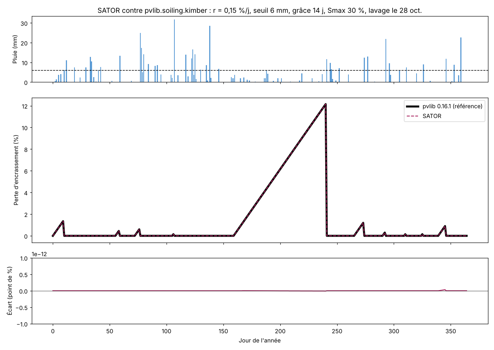

# SATOR

**S**oiling **A**ccumulation **T**hrough **O**bserved **R**ainfall

Calculateur des pertes d'encrassement photovoltaïque, mois par mois, à partir de la pluie réelle du site. Les résultats sont prêts à saisir dans PVsyst.

*Photovoltaic soiling loss calculator for France, based on the Kimber model and validated against pvlib. Interface available in French and English. [English summary below.](#english-summary)*

  

**➜ [Ouvrir SATOR](https://hasinarandyaris-eng.github.io/sator/)**


## Contexte

SATOR a été conçu pour les centrales photovoltaïques au sol d'une grande entreprise ferroviaire française. La plupart de ces sites sont situés à proximité des voies ferrées. L'outil propose donc des profils spécifiques aux sites ferroviaires, industriels et agricoles, et le profil « proximité ferroviaire » est sélectionné par défaut.

SATOR est conçu pour la France métropolitaine : carte des 13 régions, adresses de la Base Adresse Nationale (BAN) et normales de pluie françaises.

## Pourquoi

Dans une étude de productible, la perte par encrassement est souvent une valeur forfaitaire. Or cette hypothèse pèse sur toute la durée de vie de la centrale. Une valeur trop basse rend le plan d'affaires optimiste. Une valeur trop haute pénalise le projet. SATOR remplace le forfait par une hypothèse **justifiée et traçable** : douze valeurs mensuelles calculées à partir de la pluie du site.

## Ce que fait SATOR

- **Quatre sources de pluie :** Open‑Meteo (réanalyse ERA5, depuis 1940), NASA POWER (depuis 1981), saisie manuelle de cumuls mensuels, ou import d'un fichier CSV journalier.
- **Six profils d'environnement :** résidentiel, urbain, bord de route, agricole, industriel, proximité ferroviaire. Chaque valeur est sourcée ou signalée comme hypothèse.
- **Une carte des 13 régions** de France métropolitaine, avec une pluie typique par région.
- **Des lavages manuels**, en fréquence annuelle ou à dates précises.
- **Une sortie PVsyst :** douze pertes mensuelles à copier en un clic.
- **Une documentation intégrée :** le modèle, sa formule, la calibration, les limites et les sources.
- **Une interface bilingue :** français et anglais, avec détection de la langue du navigateur.

Tout tient dans un seul fichier HTML. Il n'y a ni serveur ni installation. Les données saisies ne quittent pas le navigateur.

## La méthode

SATOR applique le **modèle de Kimber** (Kimber et al., 2006), tel qu'implémenté dans la bibliothèque de référence **pvlib** (`pvlib.soiling.kimber`). Chaque jour, la perte augmente d'un taux constant. Elle revient à zéro quand la pluie du jour dépasse un seuil, ou lors d'un lavage manuel. Elle reste nulle pendant une éventuelle période de grâce, et ne dépasse jamais un plafond.

Les paramètres par défaut sont transposés au climat français à partir de sources publiées. Le détail figure dans l'outil, page « Le modèle Kimber », section « Calibration ».

| Profil | Taux | Seuil | Grâce | Plafond | Perte annuelle simulée |
|---|---|---|---|---|---|
| Résidentiel | 0,03 %/j | 6 mm | 0 j | 5 % | 0,15 à 0,26 % |
| Milieu urbain | 0,04 %/j | 6 mm | 0 j | 8 % | 0,20 à 0,35 % |
| Bord de route | 0,05 %/j | 6 mm | 0 j | 8 % | 0,25 à 0,44 % |
| Zone agricole | 0,08 %/j | 6 mm | 0 j | 10 % | 0,40 à 0,70 % |
| Zone industrielle | 0,25 %/j | 8 mm | 0 j | 15 % | 1,7 à 3,2 % |
| Proximité ferroviaire | 0,15 %/j | 12 mm | 0 j | 10 % | 1,6 à 3,4 % |

Les trois derniers profils sont des hypothèses d'ingénieur, présentées comme telles dans l'outil.

## Validation contre pvlib

Le moteur de SATOR est comparé à la fonction officielle `pvlib.soiling.kimber`. Le script donne exactement la même pluie et les mêmes paramètres aux deux calculs, puis compare les pertes jour par jour. Il teste 400 années aléatoires couvrant toute la plage des réglages, avec des cas pièges : pluie égale au seuil, forte pluie le 1er janvier, sécheresse jusqu'au plafond.

```
pvlib 0.16.1 | 400 années testées (146000 jours)
Cas différents de pvlib : 0 sur 400
Écart journalier maximal : 7.3e-13 point de %
RÉSULTAT : identique à pvlib
```



Pour rejouer le test (Python 3.9+ et Node.js 18+) :

```bash
cd validation
pip install -r requirements.txt
python compare_pvlib.py      # 400 cas aléatoires
python figure_pvlib.py       # régénère le graphique
```

Le script lit le moteur directement dans `index.html`. Il teste donc le code réellement utilisé par l'outil. La même comparaison est aussi recalculée en direct dans l'outil, page « Le modèle Kimber », section 3.

## Limites

- Le modèle suppose qu'une pluie suffisante nettoie entièrement les modules. Il ne représente pas l'encrassement permanent, par exemple près des voies ferrées.
- Les moyennes mensuelles ne sont pas pondérées par l'irradiance.
- En saisie manuelle, la pluie journalière est générée à partir des cumuls mensuels : le résultat est indicatif.
- La neige n'est pas prise en compte.
- Une mesure sur site reste préférable lorsqu'elle existe.

## Mettre l'outil en ligne avec GitHub Pages

1. Dans le dépôt, ouvrez **Settings**, puis **Pages**.
2. Choisissez **Deploy from a branch**, la branche `main` et le dossier `/ (root)`.
3. Après une minute, l'outil est en ligne à l'adresse `https://hasinarandyaris-eng.github.io/sator/`.

Le dépôt doit s'appeler `sator` pour que cette adresse, les liens de l'outil et l'aperçu LinkedIn fonctionnent.

## Sources de données et attributions

- Données météo : [Open‑Meteo](https://open-meteo.com) (CC BY 4.0) et [NASA POWER](https://power.larc.nasa.gov) (NASA Langley Research Center).
- Adresses : [API Adresse](https://adresse.data.gouv.fr) (Base Adresse Nationale).
- Tracé des régions : [R. Enguehard](https://github.com/regisenguehard/carte-france-svg), CC BY 4.0.
- Graphiques : [Chart.js](https://www.chartjs.org), licence MIT.

## Fait avec l'IA

Le code de SATOR a été écrit avec l'aide de Claude (Anthropic), un assistant d'intelligence artificielle. L'auteur a défini le besoin, orienté la méthode, validé la calibration et vérifié les résultats. Le test de validation ci‑dessus permet à chacun de contrôler le calcul.

## Auteur

**Hasina Randy Ranaivoarisoa**, ingénieur photovoltaïque.
[LinkedIn](https://www.linkedin.com/in/randy-ranaivoarisoa-76293a23b/) · [GitHub](https://github.com/hasinarandyaris-eng)

Le nom SATOR vient du carré SATOR, un palindrome latin de cinq mots : SATOR, AREPO, TENET, OPERA, ROTAS. SATOR est une création TENET. Chaque outil de la famille reprend un mot du carré, et son logo remplit en blanc la ligne correspondante de la grille 5 × 5. SATOR occupe la première ligne.

## Citer SATOR

> Ranaivoarisoa, H. R. (2026). *SATOR : Soiling Accumulation Through Observed Rainfall.* Calculateur des pertes d'encrassement photovoltaïque fondé sur le modèle de Kimber (v1.0).

Le fichier `CITATION.cff` permet aussi à GitHub d'afficher le bouton « Cite this repository ».

## English summary

SATOR (**S**oiling **A**ccumulation **T**hrough **O**bserved **R**ainfall) estimates monthly soiling losses of photovoltaic plants in France from real daily rainfall, ready to enter in PVsyst. It was designed for the ground-mounted plants of a major French railway company, most of them close to railway lines, hence dedicated profiles for railway, industrial and agricultural sites.

- Runs entirely in the browser, as a single HTML file. Nothing to install.
- Rainfall from Open‑Meteo (ERA5), NASA POWER, manual monthly totals or a daily CSV file.
- Kimber model engine **identical to `pvlib.soiling.kimber`**: 0 differences over 400 random test years (see `validation/`).
- Default parameters transposed to the French climate from published sources; engineering assumptions are flagged as such.
- Interface in French and English (FR/EN switch in the header).

The code was written with the help of Claude (Anthropic). The author defined the need, steered the method, validated the calibration and checked the results.

## Licence

Code distribué sous [licence MIT](LICENSE). Vous pouvez l'utiliser, le modifier et le redistribuer librement, à condition de conserver la mention de l'auteur. Il est fourni sans garantie.
